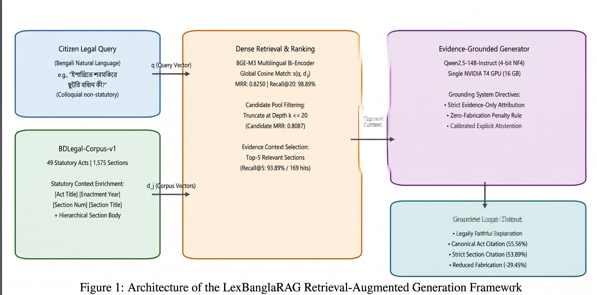

# ⚖️ LexBanglaRAG: Evidence-Grounded Statutory Legal AI Assistant

[](https://www.python.org/)
[](https://streamlit.io/)
[](https://github.com/)
[](https://github.com/)
[](https://github.com/)
[](https://creativecommons.org/licenses/by/4.0/)

An evidence-grounded Retrieval-Augmented Generation (RAG) interactive web application and benchmarking system for **Bengali Statutory Question Answering and Hallucination Analysis**. 

Developed at the **Department of Software Engineering, Daffodil International University (DIU)**.

---

## 📌 System Architecture



---

## 📓 Complete Research Notebooks Pipeline

All experimental and evaluation stages are modularized, self-contained, and reproducible in the `notebooks/` directory:

| Notebook | Research Stage & Objective | Key Output / Metric |
| :--- | :--- | :--- |
| **`01_Data_Preprocessing_and_Corpus_Builder.ipynb`** | 49 Acts extraction, text cleaning, section parsing & normalization | 1,575 statutory sections (BDLegal-Corpus-v1) |
| **`02_Chunking_Strategy_Ablation_Experiment.ipynb`** | Fixed-size vs Recursive vs Section-aware chunking ablation | Section-aware preserves statutory integrity |
| **`03_GoldQA_Benchmark_Generation_Pipeline.ipynb`** | Gemini-assisted gold dispute generation & verification protocol | 180 realistic benchmark QA pairs (BDLegal-GoldQA-180) |
| **`04_Raw_Hybrid_Retrieval_Ablation.ipynb`** | Raw BM25 vs Dense BGE-M3 baseline retrieval on raw clauses | Raw Dense BGE-M3 MRR: 0.7118 |
| **`05_Context_Enriched_Retrieval_Benchmark.ipynb`** | Statutory Context Enrichment (SCE) hierarchical prefix evaluation | Candidate MRR: **0.8087**, Recall@5: **93.89%** |
| **`06a_LexBanglaRAG_Qwen14B_Champion.ipynb`** | Primary production pipeline: Qwen2.5-14B (4-bit NF4) + SCE | Token F1: **0.3528**, Act: **55.56%**, Section: **53.89%** |
| **`06b_LexBanglaRAG_Qwen7B_Scaling.ipynb`** | Mid-scale generator evaluation: Qwen2.5-7B (4-bit NF4) | Hardware scaling audit on 16GB T4 GPU |
| **`06c_LexBanglaRAG_Gemma2_2B_Edge.ipynb`** | Edge-scale generator evaluation: Google Gemma-2 (2B FP16) | Parameter efficiency & low-latency inference |
| **`06d_LexBanglaRAG_DeepSeekR1_Reasoning.ipynb`** | Distilled reasoning model evaluation: DeepSeek-R1-Distill-Qwen | Chain-of-thought analysis & cross-lingual leakage audit |
| **`07_ClosedBook_NoRAG_Hallucination_Baseline.ipynb`** | Parametric hallucination baseline study without retrieval | Quantifies 73.89% pure fabrication failure mode |

---

## ✨ Key Features of the Web Interface

1. **🔍 Interactive Statutory Question Answering:** 
   - Ask any legal dispute question in colloquial Bengali.
   - Or select from **10+ real-world citizen dispute archetypes** across major statutory pillars (Labor Act, EPZ Labor, Child Rights, Dowry Prohibition, Child Marriage, Family Courts, Land Acquisition, etc.).
2. **📚 Transparent Evidence Inspection (Retriever):**
   - View the exact retrieved parliamentary Act, section number, chapter metadata, and verbatim legal text.
3. **⚡ RAG vs. No-RAG Hallucination Comparison (Supervisor Highlight):**
   - Compare side-by-side:
     - **LexBanglaRAG (Evidence-Grounded):** Cites verified Act titles and section numbers with legal grounding.
     - **Closed-Book AI (No-RAG Baseline):** Demonstrates parametric hallucination, showing how standard LLMs fabricate nonexistent sections (73.89% pure fabrication rate).
4. **📜 49 Parliamentary Acts Corpus Explorer:**
   - Instant search and exploration of all 1,575 codified statutory sections from 1985 to 2025.
5. **📊 Benchmark Metrics Dashboard:**
   - Full empirical evaluation tables across Qwen2.5 (3B, 7B, 14B) and Gemma-2 (2B).

---

## 🚀 How to Run Locally

### Option 1: One-Click Launcher (Windows)
Simply double-click the **`run_demo.bat`** file in the project folder. It will automatically check dependencies and launch the app in your browser!

### Option 2: Via Terminal / PowerShell
1. Open PowerShell or Command Prompt in this folder.
2. Install requirements:
   ```bash
   pip install -r requirements.txt
   ```
3. Launch the Streamlit application:
   ```bash
   streamlit run app.py
   ```
4. The application will open automatically in your browser at:
   `http://localhost:8501`

---

## 📊 Summary of Research Findings

| Model Configuration | Precision | Act Citation Accuracy | Section Citation Accuracy | Token F1 |
| :--- | :---: | :---: | :---: | :---: |
| **Qwen2.5-3B No-RAG (Closed-Book)** | FP16 | 13.89% | 18.33% (Strict: 0%) | 0.1870 |
| **Qwen2.5-14B No-RAG (Closed-Book)**| 4-bit NF4 | 16.67% | 14.44% (Strict: 1.67%) | 0.1980 |
| **Gemma-2-2B + LexBanglaRAG** | FP16 | 43.89% | 46.11% | 0.2974 |
| **Qwen2.5-3B + LexBanglaRAG** | FP16 | 50.56% | 50.00% | 0.3370 |
| **Qwen2.5-14B + LexBanglaRAG (Peak)**| 4-bit NF4 | **55.56%** | **53.89%** | **0.3528** |

- **Statutory Context Enrichment** boosts dense retrieval MRR to **0.8087** (Recall@5: 93.89%, Recall@20: 98.33%).
- Evidence grounding slashes pure statutory fabrication from 73.89% down to 44.44% ($p < 10^{-12}$).

---

## 🎓 Academic Affiliation
* **Department:** Department of Software Engineering (Major in Data Science)
* **Institution:** Daffodil International University (DIU), Dhaka, Bangladesh
* **Year:** 2026
